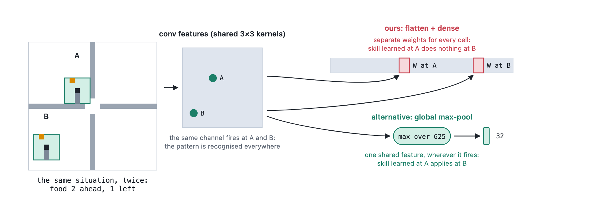

# I tried to reproduce Neural Episodic Control for two weeks. Here is what I found

*October 2026. Code, protocols and every report are in this repository; the numbers below link to them.*

I wanted to pick one idea for the memory of an agent I'm building (`dl2l`): the episodic control of
[MFEC](https://arxiv.org/abs/1606.04460) (a table of the best return seen from each situation) or of
[NEC](https://arxiv.org/abs/1703.01988) (the same idea with a learned embedding, trained end to end). NEC's headline claim is data
efficiency: early in training it beats DQN. So I set out to reproduce that claim on small games, understand every part of it, and choose.

It took two weeks, a dozen experiments and, at the end, 170 runs on a cluster. It did not reproduce. The way it failed is the interesting part.

## The setup

Everything is pure NumPy: the networks, the optimizers and every gradient, including the one through NEC's nearest-neighbour lookup. I wrote
them by hand on purpose, and checked each against finite differences. The question was an *ablation ladder*: start from DQN and add one
piece at a time (N-step returns, an episodic memory with a frozen random encoder, a learned encoder) with MFEC alongside.

## Act 1: on a small board, MFEC wins and NEC fades

On a 7×7 Snake, MFEC was the best and fastest agent (1.58 fruit per episode against 1.04 for DQN and 1.01 for NEC). It hits an exactly stored
state about a quarter of the time, so it works like a lookup table of the best outcome ever seen. Add four channels of noise to the board and it
collapses to random, because no two observations repeat. On 10×10, NEC was already near random (0.23). That was the first hint
([report](../experiments/mfec_dqn_nec/REPORT.md)).

## Act 2: make the game harder, and the encoder breaks

I scaled up to a 25×25 board with walls and bonus food, which is closer to the paper's setting. Four pre-registered pilots in a row failed their
gate: no agent learned the real game, because food was too far away to ever find. A food curriculum fixed that. Every agent ate thousands of fruit
early on. Still no agent steered toward the food.

Probing what the encoders had learned gave a clear picture: **skills were tied to board position.** NEC steered to food 91% of the time near the
start cell and at chance ten cells away. The embedding was organised by where the snake was, not by where the food was relative to it
([report](../experiments/encoder_food_probe_g25/REPORT.md)).

Then the embedding of NEC with a CNN *exploded*: its norm grew from 1 to a billion within a few thousand steps. After a lot of ablation, the
trigger was a surprise. It was the **magnitude of a constant, information-free input**, the walls. With the walls channel at 1.0, 3 of 3 runs
diverged. At 0.235, or hidden, 0 of 3 did, on two different networks. NEC's loss only sees distances between stored keys, so nothing pins the
embedding's scale, and the optimizer keeps growing a direction that moves all keys together. DQN is spared because its outputs have to match
targets ([report](../experiments/grid_ablation_rmsprop_control/REPORT.md)).

## Act 3: copy the paper, bit by bit

So I copied the paper: DQN's exact network on 84×84 pixels, the same optimizer family, absolute joystick-style actions, the paper's learning-rate
family. It still failed. With 250k steps, the paper's first reported budget, DQN reached 8.82 fruit per episode on a 10×10 board and NEC
0.78–0.88, *below a frozen random embedding* ([report](../experiments/nec_budget_eval_g10/REPORT.md)). NEC's Q-values were never tied; they just
did not point to the food.

## Act 4: a more Atari-like game, and the tuning story

I built my own small Ms. Pac-Man (fixed maze, ghosts, pixels, frame skip) to get dense rewards, closer to Atari. There, NEC finally had something to
offer, but it depended on details:

- **Reward scale.** The same NEC scored 357 with my small rewards and 519 with Atari-sized ones (10 / 50 / 200 points). The learned encoder only
  started to beat a frozen one once rewards were salient.
- **DQN's target-network sync.** A single DQN setting moved it from 478 to 668 points, past every NEC variant I had. The best arm of the whole study
  was a DQN with that setting.

Those two findings are why I stopped hunting for the configuration where NEC wins, and ran one last test.

## The final experiment

I pre-registered it: six agents on both games, fresh seeds, the best settings from the exploratory work, **1M agent steps** (4× the paper's first
budget), 10 seeds each, 170 runs ([protocol](../experiments/final_ladder/PROTOCOL.md), [report](../experiments/final_ladder/REPORT.md)).
I also added a Snake arm with the food curriculum, because I suspected it helps every agent.

| Final score | Snake (fruit) | Ms. Pac-Man (points) |
|---|---|---|
| Random | 0.13 | 56 |
| **DQN** | **9.56** | **897** |
| NEC | 1.64 | 543 |
| MFEC | 1.60 | 459 |
| Frozen-embedding EC | 1.91 | 416 |
| N-step DQN | 1.47 | 467 |

What the eight pre-registered tests said:

- **NEC does not beat DQN**, early or late, on either game. On Snake the gap is 8 fruit.
- **Learning the embedding helps on Ms. Pac-Man** (+127 points over a frozen one, the only supported test) **and not on Snake**, where it is slightly worse than a random one.
- On Snake, **every episodic agent sits at 1.5–1.9 fruit from 300k steps and does not move**, while DQN climbs the whole million. NEC steers toward the
  food at 0.48 where chance is 0.39 (DQN: 0.74).
- **NEC over MFEC on Ms. Pac-Man** was close (+84 points) but missed the registered threshold after correcting for eight tests. I had predicted it
  would pass.
- **The curriculum does not help the final score of any agent.** It speeds DQN up early (3.0 against 1.6 fruit at 250k steps) and DQN without it
  catches up. It hurts MFEC. My suspicion was wrong, and that is why the test was pre-registered.

## What I think happened, and what I can't say

The data show one thing clearly: in my setup, NEC's learned embedding is a weak lever, and its results move a lot with the reward scale and with
the configuration, while a tuned DQN improves steadily. A few things I believe, with the confidence they deserve:

- **A likely reason is the representation.** NEC reads Q from its neighbours, so if the embedding groups states by where the snake is rather than where
  the food is, the memory is blind to the food. DQN can read out other directions of its hidden layer. I measured the symptoms (position-organised
  neighbours, neighbour values as spread out as the whole memory), not the cause.
- **A tuning asymmetry in the original comparison is plausible, but I did not test it.** The NEC paper tuned NEC for the early, data-efficient regime
  and compared against Nature DQN, which was tuned for 50M frames. Later work found a well-tuned Rainbow beats a published model-based agent with less
  experience (van Hasselt, Hessel and Aslanides, 2019). In my study, one DQN setting was enough to turn "NEC leads" into "DQN leads". That is
  consistent with the idea, not proof of it.
- **I can't say anything about Atari.** These are my own games, at 4M frames at most, with exact rather than approximate nearest-neighbour search (the
  reason a NEC run took about 3 days). A fair reading is "I could not reproduce NEC's advantage in this setup", not "NEC's claim is false".

## What I'm taking to `dl2l`

**MFEC-style memory, on top of a representation learned some other way.** It was cheaper (16 hours per Ms. Pac-Man run against 62 for NEC), has nothing
to explode, does not care about reward scale, and works where states repeat. What decides whether it works is the space it looks things up in, not the
memory. NEC's end-to-end training of that space was the fragile part.

Two directions look more useful than reproducing this one further: an episodic memory of *failures* (FEMA,
[arXiv:2603.07110](https://arxiv.org/abs/2603.07110)), since early Snake training is dominated by short failures, and a JEPA-style encoder trained
from pixels, with a simple memory on top. The probes and geometry tools from this study carry over to both.

## What I'd tell you if you try this

1. **Pre-register, and keep the analysis script frozen.** The frozen tests are what kept the conclusions honest, and two of my own predictions
   did not survive them (the curriculum, and NEC over MFEC on Ms. Pac-Man).
2. **Check the scale of every input and every reward before you tune anything else.** A constant wall input and a reward unit moved results more than
   any learning rate.
3. **Tune the baseline as hard as the method.** My most useful single result was how far DQN moved with one setting.
4. **Write the boring tooling first**: gradient checks, a golden-run test that must stay bit for bit, a script that moves results off the cluster
   before the disk fills. Every one of them saved a result at some point.

*The code was developed with Claude Code; the experiments were designed, reviewed and interpreted by me, and each claim here links to its report.*
