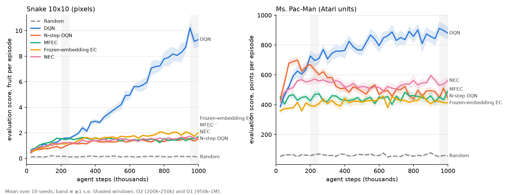
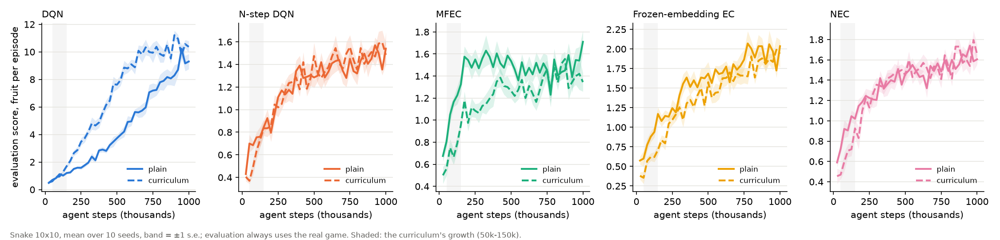

# Report: the final ladder, 1M steps on Snake 10×10 and Ms. Pac-Man (pre-registered)

**Status: complete.** Pre-registered in [PROTOCOL.md](PROTOCOL.md) (revision 2, frozen on 2026-10-13 before any run; hashes in
[FROZEN.sha256](FROZEN.sha256), commits in [FROZEN.commit](FROZEN.commit); all nine frozen files still matched their hashes when the analysis ran).
170 runs on CCAD (jobs 1705, 1745, 1777, 1801, 1811, 1822), 170 of 170 finished with exit code 0, none timed out. Every run has 1,000,000 steps and 40
evaluations, and its checkpoints at 500k and 1M. Generated outputs: [results.md](results.md), [per_run.csv](per_run.csv),
[eval_curves.png](eval_curves.png), [eval_curves_curriculum.png](eval_curves_curriculum.png). Raw results are in `results/exp_final_ladder/` (not in git).

## In short

1. **NEC does not beat DQN on either game, at the paper's first budget or at four times that.** On Snake, NEC scores 1.64 fruit per episode against
   DQN's 9.56 at the end, and is behind even early (1.22 against 1.56). On Ms. Pac-Man it scores 543 against 897, and 564 against 711 early.
2. **Learning the embedding helps on Ms. Pac-Man and not on Snake.** NEC beats the frozen-embedding agent by 127 points on Ms. Pac-Man (Holm-adjusted
   p = 0.0029, the only confirmatory test that is supported). On Snake it is 0.27 fruit *worse* than a random frozen embedding (interval excludes 0).
3. **On Snake, every episodic arm sits at 1.5–1.9 fruit per episode from about 300k steps on and does not move**, while DQN keeps improving for the whole
   million steps. NEC's near-probe steering is 0.48 (chance 0.39); DQN's is 0.74.
4. **The food curriculum does not help the agents' final score** (none of C1–C5 is supported). It makes DQN learn faster early (3.00 against 1.56 fruit
   at 200k–250k steps) and plain DQN catches up. It hurts MFEC.
5. **Seven of the eight confirmatory tests came out as predicted.** The exception is Pac-Man H4 (NEC above MFEC), which I predicted would be
   supported: it is +84 points [+23, +140], unadjusted p = 0.0095, Holm-adjusted p = 0.066, so **not supported** under the registered rule.

## Results

Evaluation score per episode (20 episodes at ε 0.05 on the real game, mean over 10 seeds, s.d. in brackets). Early is the mean over the evaluations at
200k, 225k and 250k steps (O2); final is the mean over 950k, 975k and 1M (O1).

**Snake 10×10, pixels (fruit per episode):**

| Arm | Early (O2) | Final (O1) | Wall hours per run |
|---|---|---|---|
| Random | 0.15 (0.04) | 0.13 (0.04) | 0.0 |
| DQN | 1.56 (0.17) | **9.56** (1.32) | 35.0 |
| N-step DQN | 0.95 (0.13) | 1.47 (0.21) | 40.5 |
| MFEC | 1.52 (0.18) | 1.60 (0.23) | 13.8 |
| Frozen-embedding EC | 1.18 (0.20) | 1.91 (0.22) | 28.4 |
| NEC | 1.22 (0.17) | 1.64 (0.15) | 77.3 |
| DQN + curriculum | 3.00 (0.47) | **10.23** (0.67) | 29.7 |
| N-step DQN + curriculum | 0.97 (0.16) | 1.55 (0.24) | 35.7 |
| MFEC + curriculum | 1.06 (0.14) | 1.39 (0.24) | 17.3 |
| Frozen-embedding EC + curriculum | 0.98 (0.16) | 1.92 (0.29) | 41.9 |
| NEC + curriculum | 1.15 (0.16) | 1.66 (0.20) | 72.2 |

**Ms. Pac-Man, Atari units (points per episode):**

| Arm | Early (O2) | Final (O1) | Wall hours per run |
|---|---|---|---|
| Random | 65 (13) | 56 (7) | 0.1 |
| DQN | 711 (111) | **897** (112) | 30.9 |
| N-step DQN | 635 (60) | 467 (57) | 29.5 |
| MFEC | 456 (56) | 459 (65) | 16.2 |
| Frozen-embedding EC | 397 (47) | 416 (47) | 39.3 |
| NEC | 564 (62) | 543 (77) | 62.0 |

Wall hours are for the final attempt of each run; runs that SLURM restarted (see Deviations) report only their second attempt.

## Confirmatory tests (one-sided exact permutation, 10 runs against 10, Holm-adjusted over 8, α = 0.05)

| | Game | Outcome | Claim | Difference [95% bootstrap CI] | Hedges' g | p | Holm p | Verdict | Predicted |
|---|---|---|---|---|---|---|---|---|---|
| H1 | Snake | early | NEC > DQN | −0.34 [−0.49, −0.20] | −1.90 | 1 | 1 | not supported | not supported |
| H2 | Snake | final | NEC > DQN | −7.92 [−8.69, −7.14] | −8.05 | 1 | 1 | not supported | not supported |
| H3 | Snake | final | NEC > frozen EC | −0.27 [−0.43, −0.12] | −1.35 | 1 | 1 | not supported | not supported |
| H4 | Snake | final | NEC > MFEC | +0.05 [−0.12, +0.20] | 0.22 | 0.31 | 1 | not supported | not supported |
| H1 | Pac-Man | early | NEC > DQN | −147 [−222, −73] | −1.57 | 1 | 1 | not supported | not supported |
| H2 | Pac-Man | final | NEC > DQN | −353 [−433, −274] | −3.53 | 1 | 1 | not supported | not supported |
| H3 | Pac-Man | final | NEC > frozen EC | **+127** [+73, +177] | 1.91 | 0.00037 | **0.0029** | **supported** | supported |
| H4 | Pac-Man | final | NEC > MFEC | +84 [+23, +140] | 1.12 | 0.0095 | 0.066 | not supported | supported |

Where the interval lies on the other side of 0 (H1 and H2 on both games, H3 on Snake), the report reads that as the opposite of the claim, not as a lack of
evidence.

## The food-curriculum family (C1–C5, Snake only; curriculum > plain on the final score, Holm over 5)

| | Arm | Difference [95% bootstrap CI] | Hedges' g | p | Holm p | Verdict |
|---|---|---|---|---|---|---|
| C1 | DQN | +0.67 [−0.21, +1.54] | 0.61 | 0.085 | 0.43 | not supported |
| C2 | N-step DQN | +0.09 [−0.11, +0.27] | 0.38 | 0.19 | 0.78 | not supported |
| C3 | MFEC | −0.21 [−0.41, −0.01] | −0.84 | 0.97 | 1 | not supported |
| C4 | Frozen-embedding EC | +0.01 [−0.20, +0.22] | 0.04 | 0.47 | 1 | not supported |
| C5 | NEC | +0.02 [−0.12, +0.17] | 0.11 | 0.41 | 1 | not supported |

The hypothesis that the curriculum helps every agent is not supported: it would need all five.

## Exploratory results (not pre-registered)

- **The curriculum's early effect** (difference at 200k–250k steps): DQN +1.44 [+1.16, +1.74]; MFEC −0.47 [−0.60, −0.33]; frozen EC −0.20; N-step DQN
  +0.02; NEC −0.07. So the curriculum accelerates DQN only, and that gain is gone by the end (+0.67, interval includes 0).
- **The ladder on Snake.** At the end, N-step DQN is 8.1 fruit *below* DQN (N-step returns hurt here), frozen EC is 0.44 above N-step DQN, and NEC is 0.27
  below frozen EC. Every arm is above random (+1.5 to +9.4).
- **The ladder on Ms. Pac-Man.** N-step DQN peaks at about 690 points around 100k steps and then declines to 467 (−430 against DQN at the end); I have not
  diagnosed this. NEC is above frozen EC (+127), above MFEC (+84) and below DQN (−353).
- **Snake probe at 1M steps (food within two steps).** Steering, with chance 0.39: DQN 0.74, N-step DQN 0.55, NEC 0.48, frozen EC 0.45. The linear
  read-out of the food offset (chance about 0.10) is 0.12 for DQN and 0.10 for the others. The episodic agents barely steer toward the food.
- **Memory health.** NEC and frozen EC wrote about 1M and 0.3–0.8M rows with no evictions (capacity 5e5 per action). MFEC, at its 2e4 per action, evicted
  about 477k rows on Snake and 744k on Ms. Pac-Man. NEC's largest key norm was 1.40 on Snake (no embedding explosion) and 22.6 on Ms. Pac-Man (about 20 times
  its start; I did not look into it).
- **Cost.** One NEC run took about 77 hours on Snake and 62 on Ms. Pac-Man, against 35 and 31 for DQN. The cost is NEC's exact nearest-neighbour search over
  a growing memory (up to about 250k rows per action).

## Deviations from the protocol

1. **A node crash restarted 48 tasks from step 0.** Node c4 went down ("Not responding") on 2026-10-13 from 22:35 to 23:12 UTC. SLURM requeued 48 tasks
   (job 1745: 20, 1777: 19, 1801: 4, 1811: 5) and they restarted from scratch with the same seed and settings, overwriting their partial outputs. Nothing was
   restarted twice. Each restarted task had a fresh time limit. Results are unaffected, but the wall-hour columns above count only the final attempt.
2. **The protocol was revised once before any run** (revision 2, adding the curriculum arm and C1–C5, at the experimenter's request). The 8 original tests
   and their job lines were not changed.
3. **The array throttle of the curriculum-memory job (1822) was raised from 8 to 12 at once on 2026-10-16**, when CPUs were free. This changed only when
   jobs started, not what they ran.
4. **Run times were longer than the protocol estimated** (DQN 30–40 hours against 13–15, NEC 62–77 against 30–50), because the cluster was shared by about 100
   of my tasks. The 3-day and 7-day limits were never reached.
5. **Checkpoints were moved to the Mac during the runs** with `ansible/free_checkpoints.sh`, to stay under the cluster's disk quota (soft 80 GB). A cluster
   copy was deleted only after the local copy had exactly the same size. Two bugs in this script were fixed on the way (it first looked at one spec only;
   then an `ssh -n` broke `rsync`). Neither lost data, and a hung connection near the end was fixed with ssh keepalives.
6. **Three partial-data previews of the frozen analysis were run before the last runs finished** (on the Pac-Man DQN-family arms, then the Snake arms, then
   everything finished at that point). The analysis script was not changed, and no decision depended on them.
7. **Collection into the right directory.** The first collect wrote into a worktree's `results/` instead of the main checkout; the files were merged and
   re-verified, and the collect command now passes the repository root explicitly.
8. **Cross-machine reproducibility is not assumed.** In the pre-run checks, 11 of 12 runs matched a local run bit for bit; Ms. Pac-Man NEC diverged within
   about 500 steps between the Mac and the cluster, from float noise amplified by large clipped gradients in Atari units. All confirmatory runs executed on
   the cluster, and nothing was compared across machines.

## Limitations

- **Our own games.** Snake and this Ms. Pac-Man are my designs, so the scores cannot be compared with the papers'. The budget is 1M agent steps (4M frames on
  Ms. Pac-Man), below the 10M frames at which the NEC paper compares.
- **One setting per agent, chosen on earlier seeds.** The arms' settings come from a small search on seeds 1–5, for both agents. They are not a full sweep for
  either, and NEC's key size (32), N (50) and memory-related choices were not varied.
- **Snake's DQN settings are a compromise.** One set of agent settings was used on both games (RMSProp 2.5e-4, target sync 4000, clipped rewards). On Snake this
  DQN learns slowly early (1.56 fruit at 200k–250k, where an Adam DQN reached about 9 at 250k in an earlier experiment). It favours NEC in H1, and NEC still lost.
- **MFEC's capacity (2e4 per action) is below NEC's (5e5)**, as in every earlier run. MFEC evicted heavily, so its comparison with NEC (H4) is not like for like.
- **Statistical power.** At 10 seeds per arm and the strictest Holm level, power is about 0.8 for an effect of 1.7 s.d. Pac-Man H4 (+84, g = 1.12) is in the
  region where a different correction would give a different verdict; the registered verdict stands.
- **Exact nearest-neighbour search instead of the paper's approximate one.** It is the main reason NEC runs are slow, and it is a deliberate departure.

## Conclusion

Within this setup, the claim that NEC learns faster than DQN did not hold on either game, at either 250k or 1M agent steps. NEC's learned embedding earned its keep
on Ms. Pac-Man (above both frozen-embedding EC and, less certainly, MFEC) and did not on Snake, where it was slightly worse than a random frozen embedding. DQN with
tuned settings improved throughout and was the best agent on both games. The food curriculum is a tool for speeding up DQN's early learning, not a general help.
