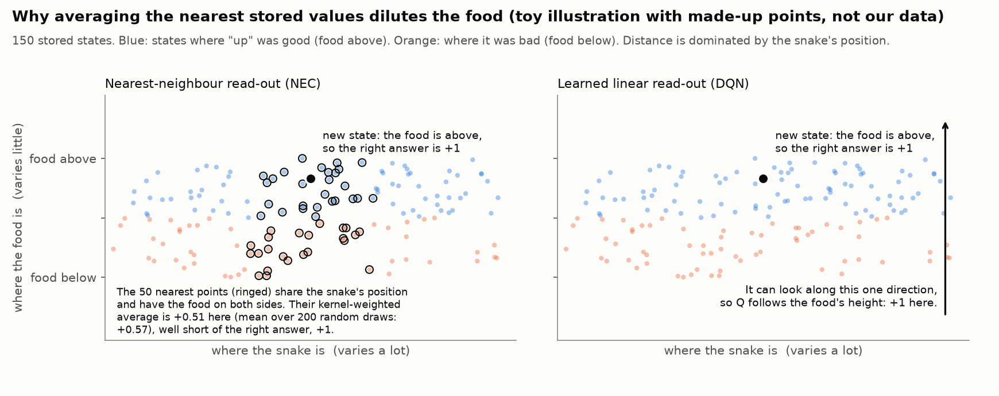
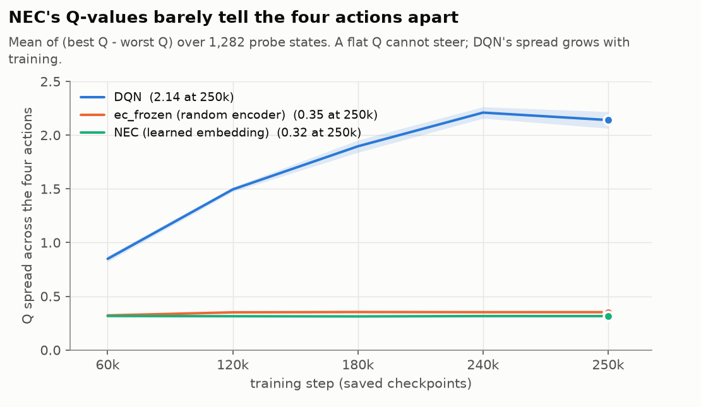
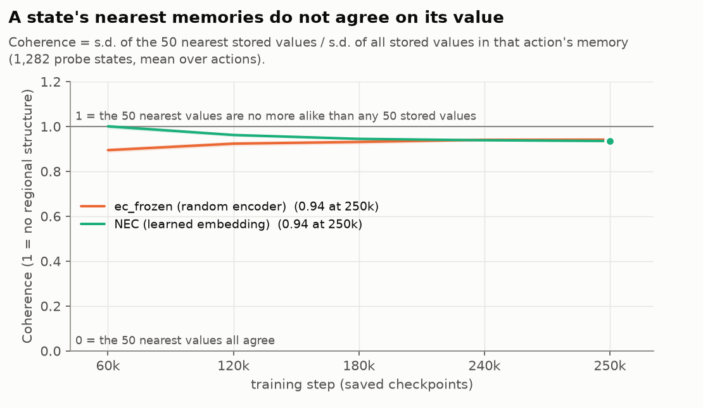
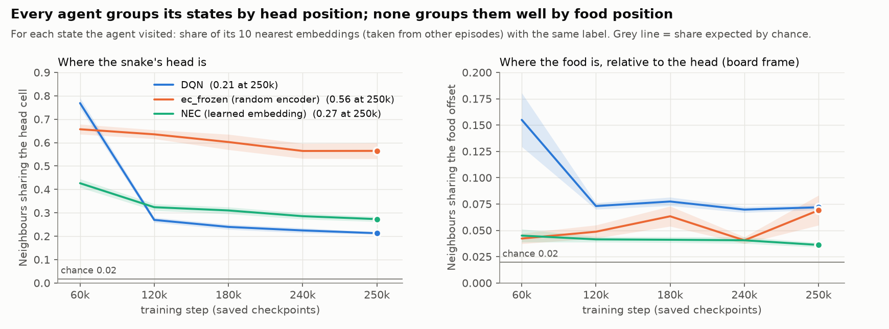
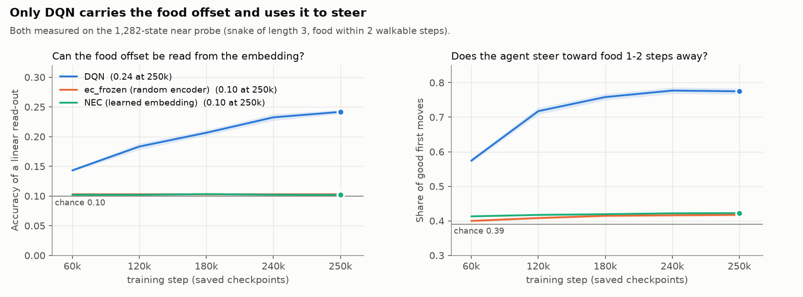
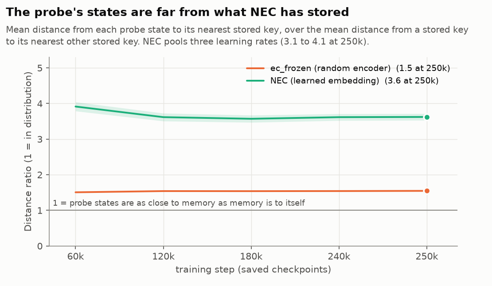

# Post-hoc analysis of the saved agents: what is inside NEC's embedding and memory?

**Status: exploratory.** Computed after the runs, from the saved checkpoints (PROTOCOL.md section 3.5), so none of it is a pre-registered test.
Code: `src/snake_rl/geometry.py` (one checkpoint), `analyze_geometry.py` (tables, [geometry.md](geometry.md)), `plot_geometry.py` (the figures below).
Data: 250 checkpoints, namely 50 runs (DQN, `ec_frozen`, three NEC learning rates; 10 seeds each) at steps 60k, 120k, 180k, 240k and 250k, analysed on CCAD (job 1541, 50 of 50 completed).
**Validation:** the probe recomputed from each saved agent equals the probe the run recorded at that step in 250 of 250 checkpoints.

## 1. Why we did this

The budget experiment (REPORT.md in the parent folder) found that NEC does not learn to steer toward food, even after 250k steps, while DQN does. This analysis looks inside the agents
to ask **what NEC's embedding and memory contain, and why NEC's Q-values do not point toward the food.** Three possible explanations were on the table:

1. The embedding does not contain where the food is, relative to the snake.
2. The embedding does contain it, but the memory lookup averages it away.
3. The probe we have been using is not a fair test of NEC.

The measures below address these one by one. Figures show means over runs, with a band of one standard error. **NEC pools its three learning rates (30 runs)** because they behave almost
alike; every per-learning-rate number is in [geometry.md](geometry.md). DQN and `ec_frozen` have 10 runs each.

## 2. Words used

- **State**: one frame stack of the board (the agent's observation).
- **Embedding or key**: the list of numbers the network turns a state into. For NEC this is the 32-number *key*; for DQN, the 512-number last hidden layer.
- **Memory (DND)**: for each action, a table of stored (key, value) rows. The *value* is the return that followed that action in that state.
- **How NEC reads a Q-value**: find the 50 stored keys nearest to the state's key (Euclidean distance) and average their values, giving closer keys more weight:
  `Q(s,a) = sum_m w_m * v_m`, with `w_m` proportional to `1 / (squared distance + 0.001)`. Nothing is learned in this step; the answer depends only on which keys happen to be nearest.
- **How DQN reads a Q-value**: a learned linear layer on the hidden layer, `Q = W h + b`. Training sets `W` so that it uses whatever directions of `h` help.
- **`ec_frozen`**: NEC with the network left at its random starting values and never trained; only the memory fills in.
- **Probe**: 1,282 hand-built states (a snake of length 3 at many positions and headings, food within 2 walkable steps), the same set at every checkpoint. **Own states**: states the saved agent actually visits when it plays 20 episodes at epsilon 0.05.
- **Chance**: the value a measure would take if there were no structure at all. Each figure marks it.

## 3. A toy picture of the idea



*Made-up points, not our data.* Each stored state has two coordinates: where the snake is (they differ a lot from state to state) and where the food is (they differ little). Distance between keys is
dominated by the large differences, so the 50 nearest points to a new state share its snake position but have the food on both sides, and their values (blue = food above, orange = below) cancel.
The kernel-weighted average comes out at +0.51 in this draw (+0.57 on average over 200 draws), well short of the right answer, +1. A learned linear read-out (right) is not bound by distance: it can look along the one direction that matters.
This is the mechanism we suspect; the figures that follow measure pieces of it in the real agents.

## 4. The measures, one at a time

### 4.1 Do the Q-values tell the actions apart? (Q spread)



- **Question.** If an agent's four Q-values are nearly equal in every state, it cannot prefer a direction.
- **How.** On each of the 1,282 probe states take the largest minus the smallest of the four Q-values, then average over states. The unit is the Q-value's own (return) unit.
- **What we see.** DQN's spread grows from 0.85 to 2.14 as it learns. NEC's and `ec_frozen`'s stay at 0.31-0.35 from the first checkpoint to the last.
- **Reading.** NEC's Q-values are never tied (the all-tied share is 0.00 in every checkpoint of the budget experiment), but they differ very little between actions, and training does not widen the differences.

### 4.2 Do the nearest memories agree? (memory coherence)



- **Question.** NEC averages the values of the 50 nearest keys. If those values agree, the average is specific to that region of key space. If they are as scattered as the whole memory, the average is close to the memory-wide mean for every state.
- **How.** For each probe state and each action, take the standard deviation of the 50 nearest stored values and divide it by the standard deviation of all values stored for that action. Average over states and actions.
  0 means the 50 neighbours all agree; 1 means they are no more alike than 50 randomly chosen stored values.
- **What we see.** 0.9-1.0 at every checkpoint, for the learned and the frozen embedding alike (0.94 at 250k).
- **Reading.** The neighbours' values are almost as dispersed as the memory as a whole, so the average carries little information about the state. This matches the flat Q-values in 4.1. It is the measured version of what the toy picture suggests; it does not by itself prove that the position-dominated geometry is the cause.

### 4.3 What does the embedding group states by? (neighbour purity on the agents' own states)



- **Question.** Does the embedding put states close together because the snake's head is in the same place, or because the food is in the same place relative to the head?
- **How.** Take the states an agent visits in 20 episodes (up to 3,000). For each state find its 10 nearest embeddings, *excluding states from the same episode* (consecutive frames would otherwise match trivially). Purity is the share of those neighbours with the same label.
  Labels: the head's cell (left panel) and the food's offset from the head, clipped to +-4 cells in each direction, in board coordinates (right panel). Chance is the share you would get by picking other-episode states at random (0.02).
- **What we see.**
  - Head position: every agent is far above chance. At 250k, DQN 0.21, NEC 0.27 and `ec_frozen` 0.56, against chance 0.02. DQN started even higher (0.77 at 60k) and moved away from it as it learned.
  - Food offset: purity is only 0.04-0.07 at 250k for all agents, against chance 0.02; DQN was higher (0.15) at 60k and fell.
- **Reading.** All three agents group their own states by where the snake is, and none groups them well by where the food is. **So "organised by position" does not by itself separate NEC from DQN**, which makes my earlier explanation (position grouping is why NEC fails) incomplete.
  DQN steers anyway, which suggests the difference lies in how Q is read out (4.4 and section 5), not in what the neighbourhoods look like.

### 4.4 Is the food offset present, and does the agent use it? (read-out accuracy and steering)



- **Question (left).** Is the food's offset from the head recoverable from the embedding at all, if you are allowed to learn a linear read-out?
- **How (left).** On the probe, standardise each embedding column and fit a ridge regression to the food offset (10 classes), with folds split by snake placement so a placement is never in both training and test. The score is held-out accuracy; chance is about 0.10.
- **Question and how (right).** Steering: on each probe state, is the agent's best action one that is safe and shortens the path to the food? Ties split evenly. Chance (a random action) is 0.39.
- **What we see.** DQN's read-out accuracy rises from 0.14 to 0.24 and its steering from 0.57 to 0.77. NEC and `ec_frozen` sit at chance on both (0.10; 0.40-0.43).
- **Reading.** The food offset is weakly present in DQN's hidden layer and is used. It is absent from NEC's key space, learned or random, at least in a form a linear read-out can find.

### 4.5 Is the probe a fair test of NEC? (probe-to-memory distance)



- **Question.** NEC can only answer well for states resembling what it has stored. Are the probe's hand-built states close to the memory?
- **How.** For each probe state, the distance to its nearest stored key, averaged; divided by the average distance from a stored key to its own nearest other stored key (a sample of 2,000 keys per action). 1 means the probe states are as close to memory as memory is to itself.
- **What we see.** 1.5 for `ec_frozen`; 3.6 for the learned NEC at 250k (3.1-4.1 across learning rates).
- **Reading.** The learned NEC's keys place the probe states about 3.6 times farther from its memory than memory is from itself, so its near-probe steering (4.4) is measured partly on states it has not stored. That weakens the probe as evidence for NEC specifically. It does not rescue NEC: its evaluation score, measured on the agent's own play, is also below the frozen embedding's.

### 4.6 One more number (table only)

How much Q depends on the food when the snake does not move (`qfood` ratio: the s.d. of Q across states that share a snake placement, over the s.d. of Q across all states, averaged over actions). At 250k: DQN 0.20 (0.30 at 60k), `ec_frozen` 0.44, NEC 0.54-0.61.
NEC's Q varies with the food *relatively more* than DQN's does, yet it does not steer. Together with the absence of ties, this says the food-dependence that exists is not aligned with the right action. Per-checkpoint values are in geometry.md.

## 5. What it adds up to

**Measured**
1. NEC's Q-values barely separate the actions, and training does not change that (4.1).
2. The 50 nearest stored values disagree almost as much as stored values in general (4.2), which is what makes the average flat.
3. The embeddings of all three agents group states by head position and none groups them well by food position (4.3).
4. The food offset is recoverable from DQN's hidden layer, weakly, and not from NEC's keys (4.4).
5. The probe's states are far from the learned NEC's memory (4.5).

**Inferred, not tested here**
- That NEC's nearest-neighbour read-out, not the position grouping itself, is what hurts it: DQN has the same grouping but reads Q through a learned linear layer that can use other directions. A direct test would give DQN a nearest-neighbour read-out on its own hidden layer, or give NEC a learned one.
- That a key which contains the food offset would let NEC steer (the oracle-key test, milestone issue #12).

**What this analysis does not show.** Purity says what the embedding groups by, not whether the grouping is right. Coherence says whether neighbours agree, not whether they are correct. Everything is correlational.

## 6. Limits

- Exploratory: nothing here was specified before the runs. One board (10x10), one render (pixels), absolute actions, 10 seeds per agent.
- On-policy figures come from 20 episodes per checkpoint at epsilon 0.05 and exclude same-episode neighbours; the chance rate is computed over other-episode states.
- The toy picture is an illustration with invented points.
- Pooling NEC's three learning rates hides small differences between them (for example the probe-to-memory ratio ranges 3.1-4.1 at 250k); see geometry.md.

## 7. Reproduce

```sh
# on the cluster (50 jobs, one per run): ansible-playbook -i inventories/ccad submit.yml -e spec=geometry_budget_eval_g10   (from ansible/)
python -m snake_rl.geometry CHECKPOINT... --out results/geometry_budget_eval_g10      # or locally, one checkpoint at a time
python docs/experiments/nec_budget_eval_g10/posthoc/analyze_geometry.py               # tables and the validation against the runs' own probes
python docs/experiments/nec_budget_eval_g10/posthoc/plot_geometry.py                  # the figures
```
