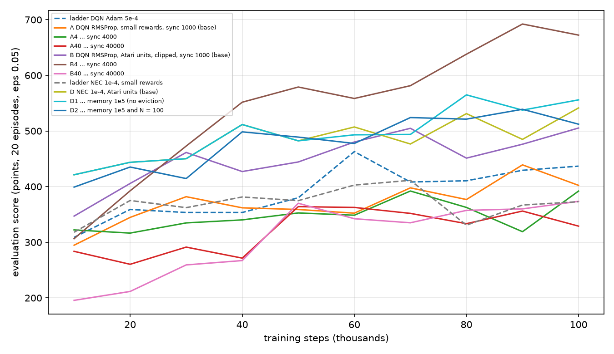

# Report: C2 (DQN target sync) and C3 (NEC memory size and N) on Ms. Pac-Man (exploratory)

**Status: complete, exploratory, not pre-registered.** Design: `ansible/experiments/pacman_c2c3.yml`, written after [pacman_calibration](../pacman_calibration/REPORT.md) and before these runs
(reasoning in [../../CALIBRATION_AUDIT.md](../../CALIBRATION_AUDIT.md)). 30 runs on CCAD (job 1647), none failed, 5 seeds each (seeds 1-5), 100k agent steps, evaluation of 20 episodes at epsilon 0.05 every 10k steps.
Table: [results.md](results.md). Figure: [eval_curves.png](eval_curves.png). Script: [analyze.py](analyze.py). Raw results: `results/exp_pacman_c2c3/`.

## In short
1. **The DQN target sync matters a lot, and the paper's DQN gets much better with a modest change.** DQN with RMSProp 2.5e-4, Atari units and clipped rewards scores **668** with a sync every 4000 agent steps, against 478 at our old 1000 (seed ranges 552-764 against 434-539, no overlap).
2. **The inflated Q-values are a target-sync effect for that DQN.** Its max-Q over the collected return falls from 2.27 (sync 1000) to 0.91 (sync 4000) to 0.29 (sync 40000, now under-estimating).
3. **The effect is not general.** Without clipping and with small rewards (arm A), both longer syncs score lower (358 and 340 against 406), and the paper's own ratio (40000) collapses to 364 even with clipping. A sync of 4000 is a sweet spot, not a rule.
4. **NEC is no longer clearly ahead of DQN.** The best DQN arm (B4, 668) is above the best NEC arm (D1, 553) by 115 points, with overlapping ranges (552-764 against 432-662). This undoes the impression from the calibration report that NEC leads.
5. **Memory size: no eviction changes the memory more than the score.** With room for 1e5 rows (0 evictions) NEC scores 553 against 519, inside the seed spread (s.d. 90 and 58). The mismatch between visited states and stored keys falls from 1.09 to 0.92. **N = 100 does nothing** (524), as expected with 35-38 step episodes.

## Results (mean of the evaluation score over 80k, 90k and 100k steps; s.d. over seeds in brackets)

| Arm | O1 (points) | Seeds | Eval episode length | Ghosts / ep | Pellets / ep | Memory rows (evictions) |
|---|---|---|---|---|---|---|
| ladder DQN Adam 5e-4 | 426 (39) | 425, 485, 442, 367, 409 | 34 | 1.01 | 15.0 | - |
| A DQN RMSProp, small rewards, sync 1000 (base) | 406 (46) | 389, 445, 373, 351, 472 | 28 | 0.85 | 15.2 | - |
| A4 sync 4000 | 358 (66) | 280, 351, 367, 476, 315 | 33 | 0.46 | 18.4 | - |
| A40 sync 40000 | 340 (23) | 318, 318, 376, 354, 331 | 32 | 0.31 | 20.7 | - |
| B DQN RMSProp, Atari units, clipped, sync 1000 (base) | 478 (34) | 467, 467, 539, 434, 481 | 31 | 0.41 | 34.2 | - |
| **B4 sync 4000** | **668** (83) | 644, 616, 761, 552, 764 | 37 | 0.54 | 44.5 | - |
| B40 sync 40000 | 364 (41) | 411, 344, 384, 294, 386 | 29 | 0.26 | 24.5 | - |
| ladder NEC 1e-4, small rewards | 357 (49) | 370, 302, 340, 444, 329 | 31 | 0.71 | 17.4 | 62945 (33027) |
| D NEC 1e-4, Atari units (base) | 519 (58) | 562, 559, 493, 417, 565 | 38 | 1.16 | 19.4 | 73682 (22289) |
| D1 memory 1e5 | 553 (90) | 630, 662, 465, 432, 574 | 37 | 1.18 | 19.7 | 95972 (0) |
| D2 memory 1e5 and N = 100 | 524 (58) | 562, 545, 494, 427, 592 | 35 | 1.15 | 19.3 | 95977 (0) |

Sync is in agent steps: 1000 = 250 updates (ours so far), 4000 = 1000 updates, 40000 = 10,000 updates (the paper's). Memory rows are summed over the 4 actions.

**Value calibration of the DQN arms** (mean max-Q over visited states against the mean discounted return collected from them; 60 episodes at epsilon 0.05 per seed; the return uses the arm's own units, clipped for B):

| Arm | ratio (max Q / return), mean over seeds | per seed |
|---|---|---|
| A sync 1000 | 7.7 | 5.3, 3.7, 18.3, 8.3, 3.2 |
| A4 sync 4000 | 5.1 | 3.9, 6.7, 1.3, 1.8, 11.6 |
| A40 sync 40000 | 3.2 (unreliable) | -6.5, -7.1, 5.8, 27.7, -4.1 |
| B sync 1000 | 2.3 | 2.3, 2.5, 2.2, 2.5, 1.8 |
| B4 sync 4000 | **0.91** | 1.0, 0.8, 0.8, 1.1, 0.8 |
| B40 sync 40000 | 0.29 | 0.3, 0.3, 0.2, 0.4, 0.2 |

The A ratios are noisy because the denominator (mean return of 0.5 or less) is close to zero, and for A40 it is negative on some seeds; the B ratios are stable across seeds.

**NEC memory geometry** (the geometry_pacman analysis on the final checkpoints, 3000 visited states per seed):

| Arm | probe vs memory (1 = visited states look stored) | memory coherence (lower = values smoother) | neighbour purity, Pac-Man cell |
|---|---|---|---|
| NEC, small rewards (ladder) | 1.26 (0.09) | 0.70 | 0.43 |
| D, Atari units | 1.09 (0.04) | 0.61 | 0.50 |
| D1, memory 1e5 | 0.92 (0.03) | 0.52 | 0.51 |
| D2, memory 1e5 and N = 100 | 0.94 (0.05) | 0.54 | 0.46 |

## What this shows
- **C2:** for the paper-style DQN (clipped, Atari units) the old sync of 1000 steps was too short: it over-estimated values 2.3x and scored 190 points less than at 4000. The inflation I flagged in the audit is therefore mostly the sync, for this DQN. For the small-reward, unclipped DQN the picture is unclear: the ratio also falls with the sync, but the score falls too.
- **The "game matters, NEC wins on Pac-Man" reading needs to be dropped to "NEC is competitive".** The calibration report compared NEC (tuned learning rate, 2 values) with a DQN at one untuned sync. With three sync values, the best DQN is the best arm of the whole study.
- **C3:** eviction was part of the memory problem. Without it the visited states sit inside the stored keys (0.92 against 1.26 at first), consistent with the evicted-key explanation and leaving little for encoder drift to explain. The score gain (+34) is inside the noise.
- **The Atari-unit reward scale also reduced the mismatch** (1.26 to 1.09 before any capacity change), so the earlier "stale keys" reading was mixing eviction and a poorly trained encoder.

## Limits (read before concluding)
- Five seeds, 100k steps (0.4M frames), my own board; the numbers cannot be compared with the paper's.
- **Selection:** B4 is the best of three sync values chosen on the same evaluation scores, so 668 is an optimistic estimate (the seed range is clean, all five above B's best seed, but there is no held-out check). The NEC arms had two capacity values, and the NEC lr was swept earlier on different reward units.
- **A and B differ in more than one way** (units, clipping, death and clear terms), so the sync effect cannot be compared across them cleanly.
- B4's score gain is not explained by calibration alone: B4 has well-calibrated values and the best score, but B40 is calibrated the other way and does worst.
- Sync is changed in agent steps, with the replay size (50k), training start (1000 rows) and Adam/RMSProp settings held; the sync interacts with all of them.
- The gradient clip (10, not in the papers) is still active for NEC and has not been removed.

## Next
1. Re-run the DQN comparison with a small, fair sweep that both agents get (sync {2000, 4000, 8000} for DQN; capacity and learning rate for NEC), with fresh seeds 11-15 for the selected arms, to remove the selection effect.
2. NEC with the gradient clip off, and the reward-scale test on Snake (food reward x10-100), which asks whether the Snake gap is also a scale effect.
3. Pre-register a 1M-frame, 10-seed confirmatory run of the paper-faithful best settings for both agents.
