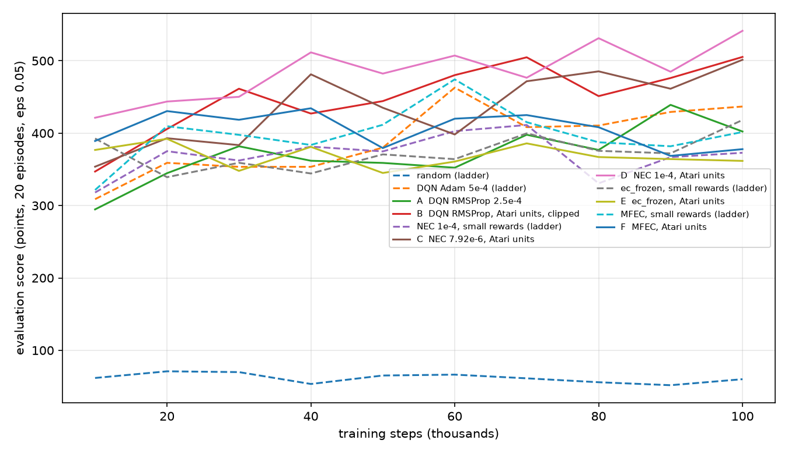

# Report: calibrating the Ms. Pac-Man ladder against the papers (C1 and C4; exploratory)

**Status: complete, exploratory, not pre-registered.** Design is `ansible/experiments/pacman_calibration.yml`, written after the first ladder and before these runs; the
reasoning is in [../../CALIBRATION_AUDIT.md](../../CALIBRATION_AUDIT.md). 30 runs on CCAD (job 1617), none failed, 5 seeds each, 100k agent steps (0.4M frames), evaluation of 20 episodes
at epsilon 0.05 every 10k steps. Table: [results.md](results.md). Figure: [eval_curves.png](eval_curves.png). Script: [analyze.py](analyze.py). Raw results: `results/exp_pacman_calibration/`.

## In short
1. **The reward scale changes the NEC result completely.** The same NEC (RMSProp 1e-4) scores 357 with our small rewards and **519** with Atari units (10 / 50 / 200 points, nothing for dying), a gain of about 160 points against seed s.d. of 50-60. NEC goes from last of the learners to first.
2. **The learned encoder now matters.** NEC beats `ec_frozen` by 119 (lr 7.92e-6) to 155 (lr 1e-4) points (483 and 519 against 364). In the first ladder the difference was nil (357 against 389).
3. **The control behaves as it should:** `ec_frozen` (364 against 389) and MFEC (385 against 390) do not train a network and do not move with the reward scale.
4. **NEC does not clearly beat the paper's DQN.** DQN with RMSProp 2.5e-4, Atari units and clipped rewards (B) scores 478; NEC is 483 (C) and 519 (D). The seed ranges overlap (B 434-539, D 417-565).
5. **Clipping changes behaviour, not the score.** Clipped DQN eats 0.41 ghosts per episode against 0.85-1.01 for the unclipped DQNs, and about twice the pellets (34 against 15), so its score does not drop.
6. **DQN's inflated values are not an optimizer effect.** With RMSProp the maximum Q is still 7.7x the return actually collected (Adam: 8.7x). C2 (target sync) is now the live candidate.

## Results (mean of the evaluation score over 80k, 90k and 100k steps; s.d. over seeds in brackets)

| Arm | O1 (points) | Seeds | Eval episode length | Ghosts / episode | Pellets / episode |
|---|---|---|---|---|---|
| random (ladder) | 56 (6) | 63, 61, 46, 51, 58 | 7 | 0.05 | 4.8 |
| DQN Adam 5e-4 (ladder) | 426 (39) | 425, 485, 442, 367, 409 | 34 | 1.01 | 15.0 |
| **A** DQN RMSProp 2.5e-4, small rewards | 406 (46) | 389, 445, 373, 351, 472 | 28 | 0.85 | 15.2 |
| **B** DQN RMSProp 2.5e-4, Atari units, clipped | 478 (34) | 467, 467, 539, 434, 481 | 31 | 0.41 | 34.2 |
| NEC 1e-4, small rewards (ladder) | 357 (49) | 370, 302, 340, 444, 329 | 31 | 0.71 | 17.4 |
| **C** NEC 7.92e-6, Atari units | 483 (39) | 504, 536, 433, 500, 441 | 34 | 1.04 | 18.1 |
| **D** NEC 1e-4, Atari units | **519** (58) | 562, 559, 493, 417, 565 | 38 | 1.16 | 19.4 |
| `ec_frozen`, small rewards (ladder) | 389 (20) | 419, 405, 379, 371, 369 | 32 | 0.73 | 16.5 |
| **E** `ec_frozen`, Atari units | 364 (44) | 333, 353, 306, 426, 404 | 31 | 0.79 | 16.3 |
| MFEC, small rewards (ladder) | 390 (33) | 337, 418, 413, 419, 366 | 29 | 1.01 | 17.0 |
| **F** MFEC, Atari units | 385 (40) | 315, 400, 369, 415, 426 | 27 | 1.06 | 16.7 |

Scores are Ms. Pac-Man points in every arm, so rows compare directly. Ghosts and pellets are per training episode in the second half of training (ghosts decoded from score and
pellet count: score - 10 x foods = 40 x power pellets + 200 x ghosts, with at most 4 power pellets).

**Value calibration** (mean max-Q over visited states against the mean discounted return collected from those states, 60 episodes at epsilon 0.05, seeds 1-5; the return uses each arm's own reward units, clipped for B):

| Arm | mean max Q | mean return-to-go | ratio |
|---|---|---|---|
| DQN Adam (ladder) | 7.25 | 0.95 | 8.7 |
| A DQN RMSProp | 2.89 | 0.49 | 7.7 |
| B DQN RMSProp, clipped | 23.5 | 10.4 | 2.3 |
| C NEC 7.92e-6 | 197 | 179 | 1.10 |
| D NEC 1e-4 | 199 | 193 | 1.04 |

## What this shows
- **C1 (optimizer): not the cause.** Switching DQN to the paper's RMSProp leaves its values inflated 7.7x and its score about the same (406 against 426, inside the seed spread).
- **C4 (reward units): the biggest effect found in this project so far on NEC.** Everything else in the NEC arm is as in the first ladder (agent, lr 1e-4, seeds, board). The paper's own value of 7.92e-6 also works on this scale (483), and NEC's memory is well calibrated (ratio 1.04-1.10), unlike DQN's.
- **The DQN-clipping story is half supported.** Clipping does cut ghost eating by about half, and with it the incentive the large rewards give; but at this budget the clipped DQN compensates with pellets and scores as well as anything.
- **The ladder's earlier answer ("the learned encoder adds nothing") was a property of our small reward scale**, at least at this budget; with Atari units the learned encoder is worth 120-155 points over a frozen one.

## Limits (read before concluding)
- Five seeds, 100k steps (0.4M frames, 4% of the paper's 10M), one board that is my own design, so numbers cannot be compared with the paper's Ms. Pac-Man scores. In the paper NEC and MFEC are close on this game (4143 against 3803 at 10M frames); here NEC is 130 points above MFEC.
- **Confound in the "Atari units" arms:** they change the scale and also remove the death penalty (-1) and the clear bonus, as in the Atari game. I did not separate the two effects.
- **Our gradient clipping is active almost everywhere in the Atari-unit NEC runs.** The global-norm clip (10, not in the papers) cut 100% of NEC updates (gradient norms 2e4-9e4, against 45% clipped with small rewards). The update is then effectively a normalised step, which may explain why lr 7.92e-6 and 1e-4 do about equally well even though the encoder moves 10x less per step at 7.92e-6 (update/weight 0.0001 against 0.001). I did not run NEC without the clip.
- DQN's inflation is not explained. The other candidates are the target-network sync (1000 steps against the paper's 10k updates), the training start (1000 rows) and plain max-bootstrapping with N = 1.
- Paper-unreported NEC settings (key size 32 against the secondary source's 128, alpha, epsilon) and the capacity (2e4 against 5e5; heavy eviction in the first ladder) are unchanged.
- Seeds 1-5 are shared across arms, so arms are paired only through the seed value, not through the same random streams.

## Next
1. NEC with the gradient clip off (or at a very large value) in Atari units, to see whether the effect survives without it.
2. Separate scale from death/clear terms: small units without the death penalty, and Atari units with a death penalty.
3. C2 for DQN (target sync) to find the inflation, and C3 (N = 100, capacity above the run length) for NEC.
4. A longer budget (1M frames, 10 seeds), since the curves of A, B, C and D are still rising at 100k.
