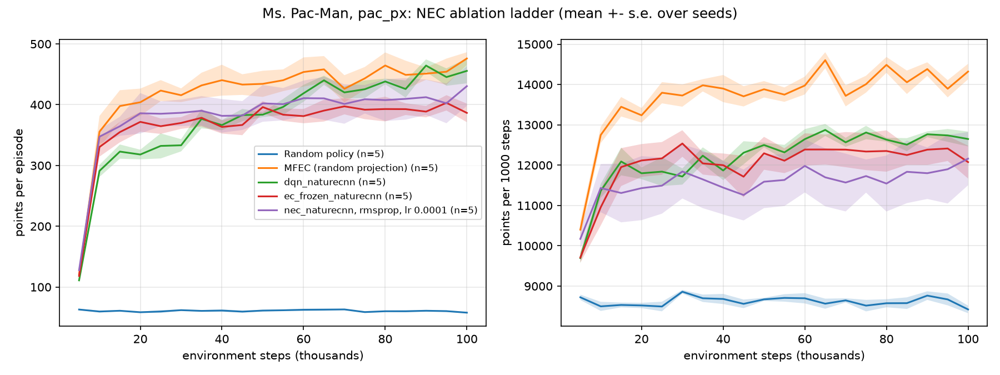

# Report: the agent ladder on a Ms. Pac-Man-like game (exploratory)

**Status: complete, exploratory, not pre-registered.** Design is the spec `ansible/experiments/pacman_ladder.yml`, written before the runs. 25 runs on CCAD
(job 1592), none failed. Raw results: `results/exp_pacman_ladder/pac_px/`. Figure: [learning_curves_pac_px.png](learning_curves_pac_px.png)
(axis labels say "fruit"; for this game the unit is Ms. Pac-Man points).

## Question
Snake gives sparse reward and NEC sits far below DQN there. Is that the game? We ran the same agents on a denser-reward game (`snake-run ... --game pacman`).

## Setup
`MsPacman`: fixed 14x14 maze, 103 pellets, 2 ghosts, 84x84 grayscale 4-frame stack, 4 absolute actions, frame skip 4, one life
(see `src/snake_rl/pacman.py`). 100k steps, seeds 1-5, evaluation of 20 episodes at epsilon 0.05 every 10k steps. Agents: `dqn_naturecnn` (Adam 5e-4),
`nec_naturecnn` (RMSProp 1e-4, the best of the Snake lr sweep), `ec_frozen_naturecnn` (no embedding learning), `mfec`, `random`.
Outcome O1 = mean evaluation score over the last three evaluations (80k, 90k, 100k), per run.

## Results

| Agent | O1 (points), mean (s.d.) | Seeds | Eval episode length (agent steps) | Wall s per run |
|---|---|---|---|---|
| random | 56 (6) | 63, 61, 46, 51, 58 | 6.9 | 12 |
| DQN | **426** (39) | 425, 485, 442, 367, 409 | 34 | 6733 |
| MFEC | 390 (33) | 337, 418, 413, 419, 366 | 29 | 1380 |
| `ec_frozen` | 389 (20) | 419, 405, 379, 371, 369 | 32 | 934 |
| NEC (RMSProp 1e-4) | 357 (49) | 370, 302, 340, 444, 329 | 31 | 5278 |

Mean evaluation score by training step (10k ... 100k): DQN 309, 359, 354, 354, 380, 463, 408, 410, 429, 437; NEC 318, 375, 362, 381, 375, 403, 411, 331, 367, 373;
`ec_frozen` 393, 339, 359, 344, 371, 364, 400, 376, 372, 418; MFEC 322, 410, 398, 384, 412, 474, 415, 387, 382, 402; random 52-71 throughout.

## What this shows
1. **The game is learnable and dense reward makes everything learn fast:** every learned agent is 6-8x random, and already ~5x random at 10k steps. On Snake at 10x10, NEC and `ec_frozen` stayed near 5x less than DQN.
2. **The ordering is much tighter than on Snake.** DQN is nominally first (426), NEC last of the learners (357), but the seed spreads overlap (DQN 367-485, NEC 302-444) and five seeds cannot separate them. On Snake at 250k steps DQN was ~8x NEC.
3. **NEC's learned embedding again adds nothing:** NEC (357) is not above `ec_frozen` (389) or MFEC (390), as on Snake. NEC's seeds are also the most spread.
4. **Everything plateaus around 400 points** (about 16-19 pellets, ~30 agent steps), when a ghost catches Pac-Man. Learning is limited by ghost avoidance, not only by pellet finding.

## Limits (read before concluding)
- Not pre-registered, five seeds, 100k steps, one maze, one NEC learning rate. DQN's curve is still rising at 100k; NEC's and `ec_frozen`'s are flat. The Snake gap opened only after 60k+ steps, so 100k here is too short to say the gap is absent.
- **This env is mine, not Atari.** Ghost speeds, reward scale and maze are my choices. Frame skip 4 gives Pac-Man 2 cells per decision, coarse for this maze; episodes are very short (random: 7 steps). No `--frame-skip 1` run was done.
- Random-policy scores include accidental pellets, so "learned" mostly means "eats ~3x more pellets and dies later". No probe (steering/decoding) is available for this game, so we cannot say whether NEC's embedding captures anything.
- It does not isolate "the game" from "board size/pixels": Snake pixel runs were at 10x10, this is 14x14.

## Tentative reading
The hypothesis that game properties (dense reward, short horizon) shrink NEC's deficit is **weakly supported, not shown**: the gap to DQN is far smaller here at equal-or-shorter budget, but the learned embedding still gives no benefit over a frozen one. The natural next steps: 250k-500k steps with 10 seeds (as in `nec_budget_eval_g10`), a `--frame-skip 1` arm, and an NEC learning-rate sweep.
